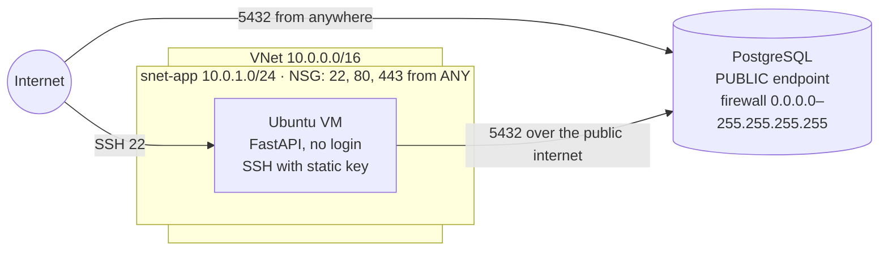
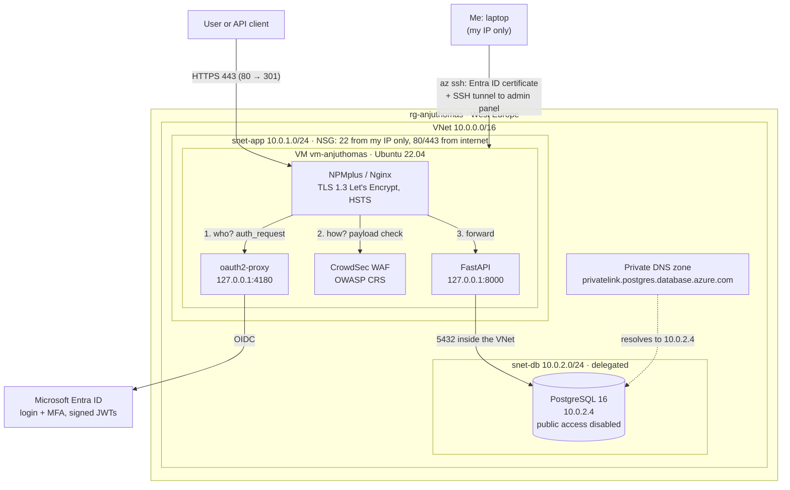

# LearningSteps Part 3: Locking Down a 2-Tier Azure Deployment

LearningSteps is a FastAPI app with a PostgreSQL database for keeping a daily learning journal. In Part 1 I built it by hand on two VMs, and in Part 2 I moved it to Terraform, Docker and AKS with a scanning pipeline. In this part I go back to a simple VM-based setup on purpose: I start from a deployment where security was ignored completely, and I harden it one layer at a time, doing most steps manually first so I understand what managed services would otherwise hide.

- the starting point is the intentionally insecure [CyberstepsDE/learningsteps-terraform](https://github.com/CyberstepsDE/learningsteps-terraform) "Base Deployment"
- every security fix is one phase, one commit and one Git tag, so the history shows each change on its own
- each phase has a write-up in `docs/` built the same way as the course: **show the gap → explain the fix → close it → prove it's closed**

Key facts:

- Repository: `4njuT0m/learningsteps-lockdown`
- Part 1 repository: [`4njuT0m/learningsteps-azure-Project`](https://github.com/4njuT0m/learningsteps-azure-Project)
- Part 2 repository: [`4njuT0m/learningsteps-evolution`](https://github.com/4njuT0m/learningsteps-evolution)
- Region: West Europe · App (while running): `https://anjuthomas.westeurope.cloudapp.azure.com` (Entra ID login required)

## Contents

- [Progress](#progress)
- [Findings: before and after](#findings-before-and-after)
- [Architecture](#architecture)
- [Repository layout](#repository-layout)
- [What I did](#what-i-did)
- [Security decisions](#security-decisions)
- [Challenges](#challenges)
- [Known issues and next steps](#known-issues-and-next-steps)
- [Key learnings](#key-learnings)
- [How to rebuild the environment](#how-to-rebuild-the-environment)
- [Cost and teardown](#cost-and-teardown)

## Progress

| Phase | Course part | Topic | Findings closed | Tag | Write-up |
| --- | --- | --- | --- | --- | --- |
| 0 | Part 1 exercise | Baseline assessment and top 5 attack scenarios | — (12 found) | `phase-0-baseline` | [00-baseline-assessment.md](docs/00-baseline-assessment.md) |
| 1 | Part 1 | Management access: Entra ID SSH, SSH only from my IP | F-01, F-02 | `phase-1-mgmt-access` | [01-management-access.md](docs/01-management-access.md) |
| 2 | Part 2 | TLS and web application firewall (NPMplus, Let's Encrypt, CrowdSec) | F-03, F-04, F-12 | `phase-2-tls-waf` | [02-tls-waf.md](docs/02-tls-waf.md) |
| 3 | Part 3 | Identity-based API access (oauth2-proxy, Entra ID) | F-05 | `phase-3-identity` | [03-identity.md](docs/03-identity.md) |
| 4 | Part 4 | Data isolation: PostgreSQL on VNet integration, backup-first migration | F-06 | `phase-4-data-isolation` | [04-data-isolation.md](docs/04-data-isolation.md) |
| — | — | Final documentation | — | `v1.0-final` | this README |

## Findings: before and after

All 12 findings come from my [baseline assessment](docs/00-baseline-assessment.md). The four course parts close 7 of them; the other 5 are outside the course scope and listed as next steps.

| ID | Weakness at baseline | Status | How |
| --- | --- | --- | --- |
| F-01 | SSH open to the whole internet | **Closed** | NSG `allow-ssh` limited to my IP (Phase 1) |
| F-02 | Login with a static SSH key file | **Closed** | Entra ID SSH with an RBAC role and ~1 h certificates (Phase 1) |
| F-03 | No public entry point and no trusted TLS | **Closed** | NPMplus reverse proxy, Let's Encrypt, Force HTTPS, HSTS (Phase 2) |
| F-04 | No web application firewall | **Closed** | CrowdSec WAF with OWASP CRS (Phase 2) |
| F-05 | API has no authentication | **Closed** | oauth2-proxy + Entra ID in front of the API (Phase 3) |
| F-06 | Database reachable from the whole internet | **Closed** | VNet integration, no public endpoint, private DNS (Phase 4) |
| F-12 | NPMplus admin uses the published default password | **Closed** | Password changed on first login (Phase 2) |
| F-07 | Detection and response never tested | Open | Sentinel rule and playbook are deployed; the course's Day 5 was removed |
| F-08 | DB password stored in plaintext (VM, tfvars, tfstate) | Open | Next step: Key Vault + managed identity, then rotate the password |
| F-09 | App connects as the DB admin user | Open | Next step: a least-privilege app user |
| F-10 | `cloud-init.yaml` binds the app to `0.0.0.0` | Open (low) | The running VM is already on `127.0.0.1` (patched by `deploy.py`) |
| F-11 | Terraform state stored locally | Open | Next step: remote state in Azure Storage |

## Architecture

### Before (baseline)



### After (hardened)



How a request travels now:

1. **TLS:** the client connects on 443; Nginx terminates TLS with a trusted Let's Encrypt certificate. Port 80 only redirects.
2. **Who:** Nginx asks oauth2-proxy whether the request carries a valid Entra ID session or bearer token. If not, the client is sent to the Microsoft login (`302`).
3. **How:** requests that pass the identity check are inspected by the CrowdSec WAF. SQL injection or XSS gets `403`.
4. **App and data:** FastAPI listens only on `127.0.0.1` and reaches PostgreSQL over the VNet. The database has no public endpoint; from outside, its name doesn't even resolve.
5. **Admin access:** SSH only from my IP, with my Entra ID identity and a short-lived certificate. The NPMplus admin panel is never exposed; I reach it through an SSH tunnel.

## Repository layout

| Path | What it is |
| --- | --- |
| `*.tf` | All Azure resources: network (incl. the delegated DB subnet and private DNS zone), VM, PostgreSQL, Sentinel and the auto-block playbook |
| `variables.tf`, `terraform.tfvars.example` | Inputs, incl. `admin_source_ip` (validated: never `*` or `0.0.0.0/0`) |
| `deploy.py` | One-command deployment from the upstream project |
| `scripts/` | cloud-init for the VM and the setup scripts for NPMplus, CrowdSec, oauth2-proxy and JSON logging |
| `templates/block-ip-playbook.json` | Logic App that adds an NSG deny rule for an attacker's IP |
| `handbook.md` | The upstream walkthrough this project follows |
| `docs/` | My phase write-ups and screenshots (`docs/screenshots/p3-<phase>-<nn>-<what>.png`) |
| `docs/ORIGINAL-README.md` | The upstream README, kept for reference |

Git-ignored on purpose: `terraform.tfvars`, `*.tfstate`, `.learningsteps_key*`, `azssh_config`, `az_ssh_config/`, `npm.cookies`, `login.json`, `plan.txt`, `*.tfplan`, `backups/` (database dumps with real data).

## What I did

### Phase 0 — Baseline assessment

- Created this repository from the upstream project and kept `upstream` as a second remote, so the first commits are the untouched baseline.
- Fixed `.gitignore`: upstream ignored the whole `docs/` folder, which would have kept every write-up and screenshot out of the repository. I also added rules for every file later phases create that holds secrets or real data.
- Deployed the baseline with `deploy.py` (24 resources, all smoke tests passed). Recorded 12 findings with evidence, plus a top-5 attack scenario risk table (likelihood, impact, priority, reason), the Part 1 group exercise done individually. Details: [docs/00-baseline-assessment.md](docs/00-baseline-assessment.md).

### Phase 1 — Management access

- Showed the gap on my own VM: **132 SSH login attempts from 5 IPs**, the first only **29 minutes** after the VM was created.
- Switched to **Entra ID SSH login**: `Virtual Machine Administrator Login` role scoped to the VM; `az ssh` issues a certificate valid for about an hour instead of a key that never expires.
- Restricted the NSG rule `allow-ssh` from `*` to my IP through a validated Terraform variable, so my IP never lands in the repo.
- Proved it: SSH from another IP times out; my Entra ID login still works; no new attacks after the change. Details: [docs/01-management-access.md](docs/01-management-access.md).

### Phase 2 — TLS and WAF

- Changed the NPMplus admin password, which was the default published in the handbook (F-12); the NPMplus audit log shows `passwordChanged: true`.
- Published the app through NPMplus and showed the gap first: Wireshark showed every journal entry in plain HTTP.
- Enabled a **Let's Encrypt** certificate with Force HTTPS and HSTS (2 years): TLS 1.3, AES-256-GCM, post-quantum hybrid key exchange (X25519MLKEM768). HTTP now redirects to HTTPS, and Wireshark shows only encrypted records (plus the SNI hostname).
- Enabled the **CrowdSec WAF** (OWASP CRS): the same SQL injection and XSS payloads went from `200` to `403`, logged as `kind: waf` alerts.
- Documented that CrowdSec shares attack signals with its central API by default. Details: [docs/02-tls-waf.md](docs/02-tls-waf.md).

### Phase 3 — Identity gate

- Showed the gap: an anonymous `POST /entries` created data with no login.
- Registered a single-tenant Entra ID app (short-lived client secret, v2 tokens, `access_as_user` scope) and put **oauth2-proxy** in front of FastAPI through NPMplus Auth Request, with no app code changes.
- Found and fixed extra issues: the oauth2-proxy secrets file was world-readable (now `600`); the WAF blocked my own admin change; the gate looked saved in the GUI but was missing from the Nginx config; Entra tokens had no `email` claim.
- Proved it: anonymous and fake-token requests get `302` to the Microsoft login; a browser login and a real JWT get `200`. Decoded the JWT locally (RS256, audience = my API, 78-minute lifetime). Showed that identity and WAF complement each other: an anonymous attack gets `302`, the same attack from a signed-in session gets `403`. Details: [docs/03-identity.md](docs/03-identity.md).

### Phase 4 — Data isolation

- Showed the gap: the database hostname resolved to a public IP and port 5432 answered from my laptop.
- **Backup first:** `pg_dump` on the VM (version 16, matching the server), verified (table, data, all 5 entries), with a second copy on my laptop in the git-ignored `backups/`.
- Moved PostgreSQL into a delegated subnet `snet-db` with a private DNS zone and **no public access**, and deleted the `allow-all` firewall rule. I saved the plan to a file, checked it (5 to add, 3 to destroy, **VM untouched**), and applied exactly that plan.
- Restored through the VM as a jump host. Proved it: inside the VNet the name resolves to `10.0.2.4`; from my laptop it doesn't resolve at all; the app shows all 5 entries again. Details: [docs/04-data-isolation.md](docs/04-data-isolation.md).

## Security decisions

| Decision | Why |
| --- | --- |
| Entra ID SSH + NSG restricted to my IP, not Azure Bastion | Identity, MFA and audit trail without extra cost; Bastion (no public SSH at all) is the production choice |
| My IP as a validated Terraform variable in the git-ignored `tfvars` | The IP never reaches GitHub, and `*` or `0.0.0.0/0` are rejected by validation |
| Role assignments scoped to the VM, not the subscription | Least privilege |
| `terraform apply -target` and saved plans (`-out`) for risky changes | An Azure Policy adds `created-on` tags, so plans showed unrelated drift; targeting kept every apply to exactly the reviewed change |
| NPMplus admin panel only through an SSH tunnel | The admin interface never appears in the NSG |
| HSTS (2 years) together with Force HTTPS | Browsers refuse later downgrades to HTTP |
| Admin changes before enabling the WAF | The WAF also protects the admin panel and can block its own admin |
| Single-tenant Entra app, client secret valid only until 2026-12-31 | Smaller blast radius if the secret leaks |
| Identity check before the WAF | Anonymous traffic never reaches the app; the WAF still covers signed-in sessions |
| Backup on the VM plus a second copy on my laptop, before the migration | Recreating the DB server destroys the data; two copies, and the dump never goes to GitHub |
| Screenshots redacted with solid boxes, never blur | Covers my IP, email, subscription and tenant IDs, and every password |

## Challenges

| Problem | Cause | Fix |
| --- | --- | --- |
| `gh repo create` failed | GitHub CLI not installed on Windows | Created the empty repo on github.com, `git remote add origin` |
| `terraform apply` → **403 AuthorizationFailed** | The CLI's default subscription was one where I have no role | `az account set --subscription "Anju Thomas - Sub"`. Signed in ≠ allowed to act |
| `terraform apply` → **401 RequestDisallowedByAzure** | Azure requires MFA for every create, update or delete, including from the CLI and Terraform | `az logout`, `az login --tenant …` with MFA |
| Laptop got registered with the Cybersteps tenant | The CLI's Windows login popup (WAM) offered "use this account everywhere" | Disconnected in Windows Settings; CLI switched to browser login |
| `terraform plan` showed 12 changes instead of 1 | Azure Policy `created-on` tags and Azure-side settings | `-target` on the intended resource |
| SSH: "Permission denied (publickey)" hours later | The Entra ID SSH certificate expires after about an hour, by design | `az ssh config … --overwrite` |
| NPMplus: "JSON.parse: unexpected character" | The WAF blocked my own admin request: a false positive | WAF off, change, WAF on |
| Identity gate "saved" but not active | The setting never reached the Nginx config | Set through the NPMplus API; verified in the generated config |
| `az ad app create` → *Insufficient privileges* | An app with the handbook's name already existed; the CLI tried to modify someone else's app | A unique app name |
| oauth2-proxy `500` after login | Entra tokens for these accounts have no `email` claim | `OIDC_EMAIL_CLAIM=preferred_username` |
| `AADSTS65001` for a token | No consent for the Azure CLI to call my API | Pre-authorized the Azure CLI as app owner |

## Known issues and next steps

Outside the course scope, but what I would do next, in this order:

1. **Secrets (F-08, F-11).** Move the DB password to Key Vault and let the VM read it with its managed identity, so it only exists in memory. Then rotate it, so the old copies in `tfvars`, `tfstate` and cloud-init are useless. Move Terraform state to a remote backend with access control and versioning.
2. **Least privilege in the database (F-09).** Create an app user with only SELECT/INSERT/UPDATE/DELETE on the entries table.
3. **Who may log in.** Every account in the Cybersteps tenant can sign in today; set *Assignment required* on the Entra enterprise app and assign only specific users.
4. **Network inside the VNet.** No NSG on `snet-db` yet; allow 5432 only from `snet-app`.
5. **Detection (F-07).** The Sentinel rule and auto-block playbook are deployed but untested. After Phase 3, anonymous attacks get `302` instead of `403`, so the "5+ 403s" rule would miss them.
6. **Configuration as code.** NPMplus, CrowdSec and oauth2-proxy settings exist only on the VM (GUI and manual edits). Rebuilding the VM would lose them.
7. **Safe default in the source (F-10).** `cloud-init.yaml` should bind to `127.0.0.1` itself.
8. **Not yet verified:** a full redeploy from a fresh clone of this repository.

## Key learnings

- **Exposure is found in minutes.** My VM got its first SSH login attempt 29 minutes after it was created, long before Shodan had indexed it.
- **Identity beats static secrets, at every layer.** SSH key → Entra ID certificate (Phase 1); anonymous API → signed, short-lived JWTs (Phase 3). Same idea: prove *who you are* right now, instead of holding a secret forever.
- **Layers change each other.** After the identity gate, anonymous attacks get `302` instead of `403`. The WAF still matters, but it sees less, and so does any detection rule built on its alerts.
- **"Saved" is not proof.** The NPMplus GUI accepted the identity gate setting, yet the generated Nginx config showed it was off. Only testing from outside, the "prove it's closed" step, caught it.
- **Read the plan before you apply.** Saved, targeted plans made the destructive database migration safe: I knew exactly what would be destroyed, and that the VM would not be.
- **Security tools need care too.** The WAF blocked its own admin, CrowdSec shares attack data by default, and a default admin password was published in the course handbook.

## How to rebuild the environment

Prerequisites: Python 3.8+, Terraform 1.5+, Azure CLI with the `ssh` extension (`az extension add --name ssh`), and Owner on the subscription (needed for the role assignments).

```powershell
git clone https://github.com/4njuT0m/learningsteps-lockdown
cd learningsteps-lockdown
az config set core.enable_broker_on_windows=false
az login --tenant <tenant-id>                         # with MFA
az account set --subscription "<your subscription>"
$env:TF_VAR_admin_source_ip = "$(curl.exe -s -4 ifconfig.me)/32"
python deploy.py --prefix <unique-name> --location westeurope
```

- `deploy.py` writes `terraform.tfvars` itself, without `admin_source_ip`, so the IP for the SSH rule is passed as the environment variable `TF_VAR_admin_source_ip`.
- The database password may only contain letters, digits, `-` and `_`, because `vm.tf` puts it unescaped into a `postgresql://` URL.
- A fresh deployment already creates PostgreSQL with VNet integration. The manual steps for the other phases (role assignment, NPMplus, TLS, WAF, Entra app, oauth2-proxy) are in each phase's write-up.

## Cost and teardown

Deallocate the VM when not working on it:

```powershell
az vm deallocate --resource-group rg-<prefix> --name vm-<prefix>
az vm start      --resource-group rg-<prefix> --name vm-<prefix>
```

Remove everything at the end:

```powershell
terraform destroy
az ad app delete --id <app-id>          # the Entra ID app registration from Phase 3
Remove-Item -Recurse az_ssh_config, azssh_config, backups   # local keys and the data dump
```
