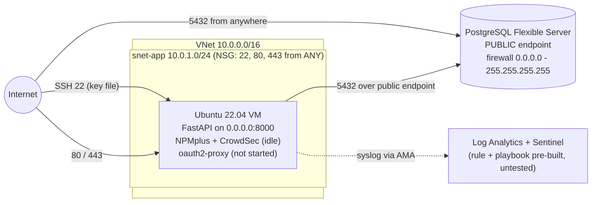

# Phase 0 — Baseline Security Assessment

**Date:** 2026-11-07 · **Scope:** the untouched `CyberstepsDE/learningsteps-terraform` deployment (commit tagged `phase-0-baseline`) · **Region:** West Europe

Before changing anything, I deployed the base environment exactly as provided and recorded every weakness I could prove. Each later phase fixes one or more findings from this table, and each phase write-up links back to its finding IDs.

## What gets deployed

## Findings

Severity is my own rating for this lab (High = directly exploitable from the internet).

| ID | Weakness | Where in the code | Why it matters | ATT&CK technique | Severity | Fixed in |
|---|---|---|---|---|---|---|
| F-01 | SSH (22) open to any IP | `network.tf` → `allow-ssh`, `source_address_prefix = "*"` | Anyone on the internet can try to brute-force or exploit SSH | T1110 Brute Force, T1021.004 Remote Services: SSH | High | Phase 1 |
| F-02 | Login uses a static SSH key file | `vm.tf` → `admin_ssh_key`; `deploy.py` creates `.learningsteps_key` | A stolen key works forever, has no MFA and no per-person audit trail | T1552.004 Private Keys | Medium | Phase 1 |
| F-03 | No public entry point and no trusted TLS for the app | NPMplus runs, but no proxy host or certificate is configured; port 80 only redirects to HTTPS. The first way to publish the app (Part 2, Demo 3) is plain HTTP | Credentials and data could be read or changed in transit | T1040 Network Sniffing, T1557 Adversary-in-the-Middle | High | Phase 2 |
| F-04 | No web application firewall | CrowdSec installed but not enabled | SQL injection and XSS payloads reach the application unfiltered | T1190 Exploit Public-Facing Application | High | Phase 2 |
| F-05 | API has no authentication | FastAPI app, no auth layer; oauth2-proxy not started | Anyone who can reach it can read, create and delete all entries | T1190 Exploit Public-Facing Application | High | Phase 3 |
| F-06 | Database reachable from the whole internet | `postgresql.tf` → public server + `allow_all` firewall rule | Attackers can brute-force the DB login directly, bypassing the VM | T1133 External Remote Services, T1110 Brute Force | High | Phase 4 |
| F-07 | Detection and response never tested | `sentinel.tf` rule + `templates/block-ip-playbook.json` (deployed, but the course's Day 5 was removed) | Nobody knows if an attack would actually raise an incident or be blocked | — (defensive gap) | Medium | Open: next step |
| F-08 | DB password stored in plaintext | `vm.tf` `custom_data` → cloud-init → systemd unit; `terraform.tfvars`; `terraform.tfstate` | Anyone with VM read access, or the state file, gets full DB admin | T1552.001 Credentials in Files | High | Open: next step |
| F-09 | App connects as the DB **admin** user | `vm.tf` → `database_url` uses `db_admin_username` | An app bug (e.g. SQL injection) runs with full admin rights | T1078 Valid Accounts | Medium | Open: next step |
| F-10 | App binds to all interfaces in the Terraform source | `scripts/cloud-init.yaml` → `uvicorn --host 0.0.0.0`. `deploy.py`'s NPMplus step later rewrites it to `127.0.0.1`, but a VM rebuilt by Terraform alone listens on `0.0.0.0` until that script runs | Defence in depth: the safe value should come from the source, not from a later patch | — | Low | Open: next step |
| F-11 | Terraform state kept locally | No `backend.tf` (only `backend.tf.example`) | All secrets sit in a local file with no locking, versioning or access control | T1552.001 Credentials in Files | Medium | Open: next step |
| F-12 | NPMplus admin uses a default password that is published | `scripts/setup-npmplus.sh` → `INITIAL_ADMIN_PASSWORD`; also printed in `handbook.md` | Anyone who reaches the admin panel (tunnel or VM access) can take over the proxy, TLS and WAF config | T1078.001 Default Accounts | Medium | Phase 2 |

## Top 5 attack scenarios

The Day 1 exercise: five realistic attacks on this deployment, rated before any fix. Likelihood and impact are High / Medium / Low; priority 1 is fixed first.

| Priority | Scenario | Likelihood | Impact | Why | Findings | Closed in |
|---|---|---|---|---|---|---|
| 1 | **Leaked SSH key → server takeover.** `.learningsteps_key` is committed to a public repo; bots find it within seconds, log in over the open port 22, wipe the database and leave a ransom note | High | High | Scanners watch GitHub for keys and the internet for port 22 (Shodan, Masscan). The key never expires and nothing logs who used it | F-01, F-02 | Phase 1 |
| 2 | **Direct attack on the public database.** A scanner finds 5432 on `psql-<prefix>.postgres.database.azure.com`, brute-forces or reuses the admin password, then dumps or deletes all entries | High | High | The firewall allows 0.0.0.0–255.255.255.255, so the VM, NSG and WAF are all bypassed | F-06, F-08 | Phase 4 |
| 3 | **Anonymous data destruction through the API.** Once the app is published, anyone calls `DELETE /entries` or `PATCH` and wipes or rewrites the journal | High | High | No login, no audit trail, no way to block one user. `deploy.py`'s own smoke test shows DELETE works without credentials | F-05 | Phase 3 |
| 4 | **Web attacks and sniffing on the public endpoint.** SQL injection or XSS payloads reach FastAPI; on public Wi-Fi, plain HTTP lets an attacker read or change requests and steal session tokens | Medium | High | No WAF and no TLS. Tokens sent over HTTP can be replayed | F-03, F-04 | Phase 2 |
| 5 | **Stolen plaintext credentials → full DB admin.** Someone with read access to the VM, a leaked `terraform.tfstate` or the NPMplus default login gets the DB admin password or control of the proxy | Medium | High | The password is on disk in three places, the app uses the admin account, and the NPMplus password is published in the handbook | F-08, F-09, F-11, F-12 | Phase 2 (F-12); rest open |

## Evidence

Commands are for PowerShell on my laptop unless marked **(on VM)**. Replace `<prefix>` with my deployment prefix.

> **Redact before committing:** blur the DB password, subscription ID, tenant ID and my home IP in every screenshot.

| # | Proves | Command | Expected result | Screenshot |
|---|---|---|---|---|
| 1 | Deployment worked | `terraform output` | IP, FQDN, resource names | `p3-0-01-terraform-output.png` |
| 2 | F-01 | `az network nsg rule list -g rg-<prefix> --nsg-name nsg-app -o table` | 22, 80, 443 with source `*` | `p3-0-02-nsg-open.png` |
| 3 | F-01, F-02 | `ssh -i .learningsteps_key azureuser@<vm-ip>` | Login with only a key file, from any network | `p3-0-03-ssh-keyfile.png` |
| 4 | F-06 | `az postgres flexible-server firewall-rule list -g rg-<prefix> --server-name psql-<prefix> -o table` | `allow-all` 0.0.0.0 – 255.255.255.255 | `p3-0-04-db-firewall.png` |
| 5 | F-06 | `Test-NetConnection psql-<prefix>.postgres.database.azure.com -Port 5432` | `TcpTestSucceeded : True` from my laptop | `p3-0-05-db-reachable.png` |
| 6 | F-05 | **(on VM)** `curl -s localhost:8000/entries` | JSON entries, no login asked | `p3-0-06-api-no-auth.png` |
| 7 | F-10 | **(on VM)** `sudo grep -- --host /var/lib/cloud/instance/user-data.txt; sudo ss -tlnp \| grep 8000` | Source says `0.0.0.0`, running service shows `127.0.0.1:8000` (patched by `deploy.py`) | `p3-0-07-bind-address.png` |
| 8 | F-08 | **(on VM)** `sudo systemctl cat learningsteps \| grep DATABASE_URL` | Full connection string with password | `p3-0-08-password-systemd.png` |
| 9 | F-08 | **(on VM)** `sudo grep postgresql:// /var/lib/cloud/instance/user-data.txt` | Same password in cloud-init data | `p3-0-09-password-cloudinit.png` |
| 10 | F-08, F-11 | `Select-String -Path terraform.tfstate -Pattern administrator_password` | Password in plaintext in local state | `p3-0-10-password-tfstate.png` |
| 11 | F-03 | `curl.exe -i http://<fqdn>/` | `301` to HTTPS from NPMplus's default config: the app itself has no public entry point yet (Part 2, "Gap 1") | `p3-0-11-http-only.png` |
| 12 | F-04 | `curl.exe -i "http://<fqdn>/entries?id=1+UNION+SELECT+*+FROM+users"` | `301` like every request, not a `403`: nothing inspects the payload. The full "payload reaches the app" proof needs a proxy host, so it is shown in Phase 2 (Demo 6) | `p3-0-12-no-waf.png` |
| 13 | F-12 | `Select-String -Path scripts\setup-npmplus.sh -Pattern INITIAL_ADMIN` | Default admin email and password in the repo | `p3-0-13-npmplus-default-creds.png` |

If SSH on Windows refuses the key with "UNPROTECTED PRIVATE KEY FILE", restrict it to my user:
`icacls .learningsteps_key /inheritance:r /grant:r "$($env:USERNAME):R"`

## Notes from the assessment

- Port 80 did not answer with plain HTTP as I expected: NPMplus's default config already redirects everything to HTTPS (`301`). The app is still not reachable from the internet, because no proxy host exists yet. So the "unencrypted" and "no WAF" gaps (F-03, F-04) are proven in Phase 2, right after the proxy host is created and before TLS and the WAF are switched on.
- `deploy.py` rewrites the app's bind address from `0.0.0.0` to `127.0.0.1` after cloud-init (row 7), so F-10 is only a weakness of the Terraform source, not of the running VM.
- The NPMplus default password (F-12) is already public in the upstream repo and handbook; I still redacted it in the screenshot out of habit.

## Summary

12 findings: 6 High, 5 Medium, 1 Low. The biggest risks are the internet-facing database (F-06), the unauthenticated API (F-05) and the plaintext DB password (F-08). Phases 1–4 follow the four course days (management access, transport and WAF, identity, data isolation) and close F-01 to F-06 and F-12. F-07 to F-11 are outside the course scope and listed as next steps in the README.
