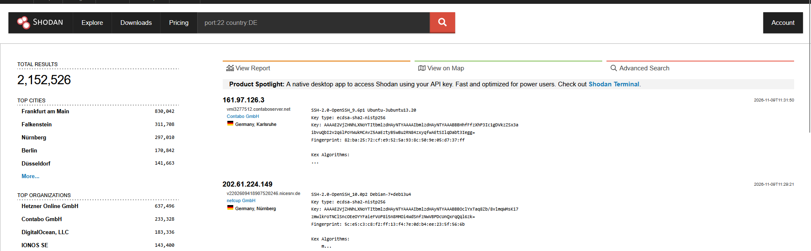
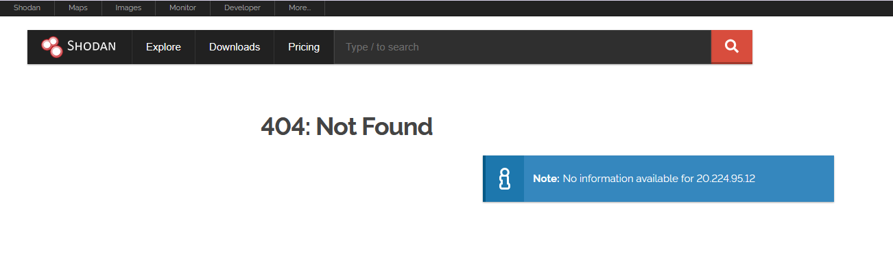
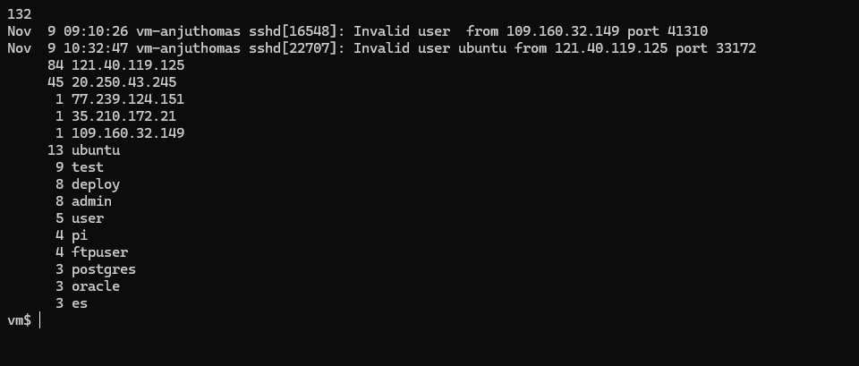
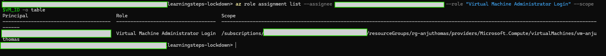
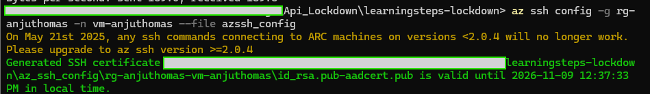
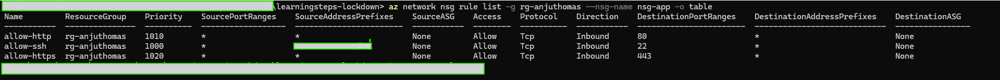
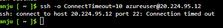
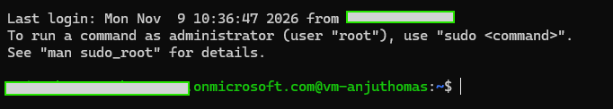

# Phase 1 — Locking Down Management Access

**Course:** LearningSteps Lockdown, Part 1 · **Date:** 2026-11-09 · **Closes:** F-01, F-02 · **Tag:** `phase-1-mgmt-access`

SSH no longer accepts connections from the internet, and I log in to the VM with my Entra ID identity instead of a key file. Two independent controls now protect management access: the **NSG** decides which network source may reach port 22, and the **RBAC role** decides who may log in to the operating system.

## 1. Show the gap

**Anyone can find an open SSH port.** Shodan lists **2,152,526** hosts with port 22 open in Germany alone, each with its SSH software version in the banner. Attackers don't need to know a server exists; they search lists like this or run their own internet-wide scanners (Masscan, ZMap).



Shodan had not indexed my VM yet, because it was only a few hours old. The attackers' own scanners were much faster.



**My VM was attacked 29 minutes after it was created.** The VM was created at 08:41 UTC with port 22 open to `*`. `/var/log/auth.log` shows:

| Measure | Value |
|---|---|
| Login attempts with invalid usernames | **132** |
| First attempt | 09:10:26 UTC (29 min after creation) |
| Last attempt | 10:32:47 UTC |
| Source IPs | 5: `121.40.119.125` (CN, Alibaba Cloud, 84 attempts), `20.250.43.245` (CH, Microsoft Azure, 45), and single probes from Google (BE) and BANATSYNC (DE, NL) |
| Most tried usernames | `ubuntu` (13), `test` (9), `deploy` (8), `admin` (8), `user`, `pi`, `ftpuser`, `postgres`, `oracle`, `es` |

The main attacker tried one username about every 2 seconds, which is an automated dictionary attack. The source countries say little about the people behind it: almost all attempts came from rented cloud servers.



**Why it matters even though every attempt failed.** The VM only accepts SSH keys, so password guessing cannot succeed. The real risks are:

- **A leaked key** (the Part 1 scenario): `.learningsteps_key` gets committed to a public repo, bots find it within seconds, log in, wipe the database and leave a ransom note. The key never expires and nothing records who used it.
- **A bug in the SSH server itself**, reachable by anyone while port 22 is open to the world.

## 2. Explain the fix

### Static keys vs identity

| | Static SSH key (before) | Entra ID login (after) |
|---|---|---|
| What grants access | A file on disk, copyable, can be committed by mistake | A person in the directory |
| Lifetime | Forever, until someone rotates it everywhere | The certificate `az ssh` creates is valid for about **1 hour** |
| MFA | No | Yes, enforced by Entra ID |
| Revoking one person | Rotate the key for everyone | Remove that person's role |
| Audit trail | None | Every sign-in is logged in Entra ID (user, time, IP, device) |

### Options considered

| Option | What it does | Why I did / didn't choose it |
|---|---|---|
| **Entra ID SSH login** + NSG restricted to my IP | Identity-based login; port 22 open only to one IP | **Chosen.** No extra cost, works with the existing VM, matches the course demo |
| **Azure Bastion** | Removes public SSH entirely; you connect through the Azure portal from inside Azure | Strongest option (no port 22 on the internet at all), but a separate paid service billed while it runs. Covered earlier in the course. The right choice for production |

### How an NSG evaluates traffic

- Rules are checked from the **lowest priority number** upward; the **first match wins** and evaluation stops.
- If no rule matches, the built-in **DenyAllInBound** rule at priority **65500** drops the packet.
- `deploy.py`'s allow rules start at priority **1000** on purpose. The Sentinel auto-block playbook creates deny rules at **100–199**, so they are checked first and can override an allow rule.

After my change, a packet from any IP other than mine matches no allow rule for port 22 and falls through to the default deny. That is why an outside connection **times out** (it gets no answer) instead of being refused.

### Two layers, both required

The Part 1 quiz: Entra ID login is set up, the NSG allows my IP, but `az ssh` still fails. The missing piece is the **Virtual Machine Administrator Login** role. The NSG controls the **network path**; RBAC controls **OS login**. Being Owner of the subscription is not enough to log in to the VM, because Azure separates managing resources from logging in to a machine.

## 3. Close it

### Demo 1 — Entra ID SSH login

`vm.tf` already gives the VM a system-assigned managed identity and installs the `AADSSHLoginForLinux` extension. The only missing piece is the role, scoped to the VM, not the subscription (least privilege):

```powershell
$VM_ID = az vm show -g rg-anjuthomas -n vm-anjuthomas --query id -o tsv
az role assignment create --assignee <my-entra-account> --role "Virtual Machine Administrator Login" --scope $VM_ID
az role assignment list --assignee <my-entra-account> --role "Virtual Machine Administrator Login" --scope $VM_ID -o table
```

`az role assignment list` needs `--scope`; without it, it returns an empty list even when the role exists.



```powershell
az ssh vm -g rg-anjuthomas -n vm-anjuthomas
whoami     # my Entra ID account, not azureuser
```


For the later phases (SSH tunnels to NPMplus), I generated an SSH config. It contains a key pair plus an Entra-signed certificate that **expires after about an hour**:

```powershell
az ssh config -g rg-anjuthomas -n vm-anjuthomas --file azssh_config
```



`az ssh config` writes the private key to `az_ssh_config/` inside the project folder. I added `az_ssh_config/` and `id_rsa*` to `.gitignore` so it can never be pushed.

### Demo 2 — Restrict SSH to a trusted IP

Instead of hard-coding my IP in `network.tf` (it would end up on GitHub), I added a variable with a validation that rejects "allow everything" values:

```hcl
# network.tf, rule allow-ssh
source_address_prefix = var.admin_source_ip

# variables.tf
variable "admin_source_ip" {
  type = string
  validation {
    condition     = can(cidrhost(var.admin_source_ip, 0)) && !contains(["*", "0.0.0.0/0", "Internet", "Any"], var.admin_source_ip)
    error_message = "admin_source_ip must be a single IPv4 CIDR such as 203.0.113.10/32, never * or 0.0.0.0/0."
  }
}
```

The real value is in the git-ignored `terraform.tfvars`. I got my IPv4 address with `curl.exe -s -4 ifconfig.me`; the `-4` matters, because an IPv6 address would lock me out of an IPv4-only VM. `terraform.tfvars.example` shows the format with a documentation IP.

**The plan showed 12 changes instead of 1.** Only the NSG change was mine. The other 11 were drift:

- The course subscription uses an Azure Policy that adds a `created-on` tag to every new resource. Terraform doesn't know the tag and wanted to remove it from 10 resources.
- Azure had switched on `vm_agent_platform_updates_enabled` on the VM.
- Azure stored the playbook deployment's parameter names with different upper/lower case.

None of these are security changes, and I didn't want to touch the VM for no reason, so I applied only the NSG:

```powershell
terraform apply -target="azurerm_network_security_group.app"
```



## 4. Prove it's closed

**From any other IP, SSH times out.** Azure Cloud Shell has a different public IP from my laptop:



`Connection timed out`, not `Permission denied`: the packets are dropped by the NSG before SSH ever sees them.

**From my IP, Entra ID login still works:**



**The attacks stopped.** The NSG change went live at about 11:10 UTC. The `auth.log` screenshot above was taken at 11:50 UTC, and its last invalid login attempt is still 10:32:47 UTC: no scanner reached SSH in the 40 minutes after the fix, after 132 attempts in the 2.5 hours before it.

## Trade-offs and what is still open

- **The static key still exists.** The VM resource requires an `admin_ssh_key`, and `deploy.py` uses `.learningsteps_key` for its own setup steps. I treat it as a break-glass key: git-ignored, kept only on my laptop, never used by hand.
- **My home IP can change.** Most home internet providers change the IP from time to time. If SSH suddenly times out, I update `admin_source_ip` and apply again. Bastion or Just-in-Time VM access would avoid that.
- **HTTP and HTTPS (80, 443) are still open to everyone.** That's intended: they become the app's public entry point in Phase 2.
- **The `created-on` tag drift** keeps appearing in every plan until Terraform is told to ignore that tag.

## Files changed

| File | Change |
|---|---|
| `network.tf` | `allow-ssh` source: `"*"` → `var.admin_source_ip` |
| `variables.tf` | New variable `admin_source_ip` with validation |
| `terraform.tfvars.example` | Example value for `admin_source_ip` |
| `.gitignore` | Ignore `az_ssh_config/`, `id_rsa*`, `plan.txt`, `*.tfplan` |
