# Phase 2 — Encryption and a Web Application Firewall

**Course:** LearningSteps Lockdown, Part 2 · **Date:** 2026-11-09 · **Closes:** F-03, F-04, F-12 · **Tag:** `phase-2-tls-waf`

The app is now reachable from the internet, but only through NPMplus (Nginx). NPMplus encrypts every request with a trusted Let's Encrypt certificate and inspects it with the CrowdSec WAF before anything reaches FastAPI. SQL injection and XSS payloads that returned `200` before now return `403`. The NPMplus admin password is no longer the default value published in the handbook.

```text
Internet ──443/TLS──▶ NPMplus (Nginx + CrowdSec WAF) ──http──▶ FastAPI on 127.0.0.1:8000
         ──80──────▶ 301 redirect to HTTPS
Admin    ──SSH tunnel (Entra ID)──▶ NPMplus admin panel on localhost:81 (never in the NSG)
```

## 1. Show the gaps

### Gap 1 — The app has no public entry point

Day 1 secured *who* can manage the VM, but the app itself was only reachable from inside the VM. Through the Entra ID SSH tunnel from Phase 1 it works:

```powershell
ssh -F azssh_config -L 8000:localhost:8000 -L 8081:localhost:81 20.224.95.12
curl.exe -s http://localhost:8000/entries
```

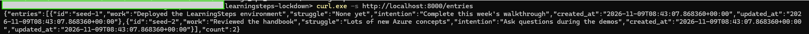

### Gap 0 — The admin panel still used the published default password (F-12)

`scripts/setup-npmplus.sh` creates the NPMplus admin as `admin@learningsteps.local` / `LearningSteps123!`, and the handbook prints the same values. The panel is only reachable through the SSH tunnel, but anyone with VM access, or a stolen tunnel, could take over the proxy, its certificates and the WAF config.

### Gap 2 — Publishing the app over plain HTTP exposes everything

I created the proxy host first **without** TLS (domain `anjuthomas.westeurope.cloudapp.azure.com` → `http://127.0.0.1:8000`):

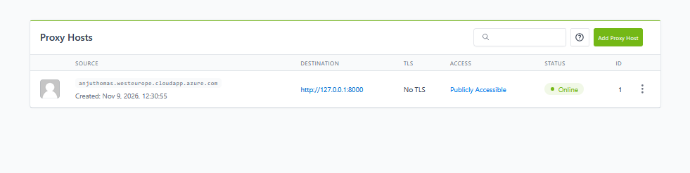

Wireshark on my Wi-Fi interface, following the HTTP stream of one `curl` request, shows the complete request and **every journal entry in plain text**. Anyone on the same network, at my ISP or on the path to Azure could read or change it: an Adversary-in-the-Middle (AitM) attack. Once Phase 3 adds login, the same would apply to identity tokens.

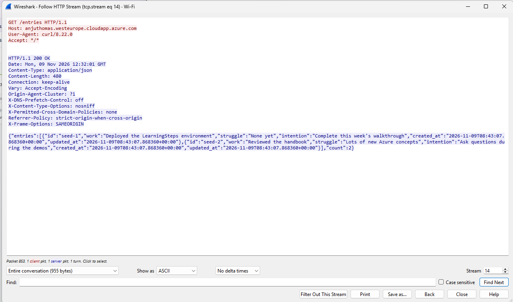

### Gap 3 — Nothing inspects the requests

With TLS working but no WAF, both classic attack payloads reached FastAPI and returned `200 OK`:

```powershell
curl.exe -i "https://anjuthomas.westeurope.cloudapp.azure.com/entries?id=1+UNION+SELECT+*+FROM+users"
curl.exe -i "https://anjuthomas.westeurope.cloudapp.azure.com/entries?q=%3Cscript%3Ealert(1)%3C%2Fscript%3E"
```

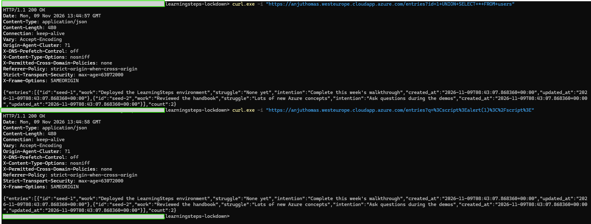

The app happens to ignore these parameters, but nothing stood between an attacker and any real vulnerability. Nothing limited request floods (spam, DoS) either.

## 2. Explain the fix

### TLS and certificates

- **TLS** encrypts and integrity-protects traffic between client and server, so a middleman can neither read nor modify it.
- **A certificate** proves the server's identity. It is only trusted if a Certificate Authority (CA) that browsers already trust has signed it: the **chain of trust**.
- **No trusted certificate for a raw IP.** A CA needs a domain name to verify. Azure gives one for free through `domain_name_label` on the public IP in `vm.tf` (`terraform output -raw domain_name` → `anjuthomas.westeurope.cloudapp.azure.com`).

| | Self-signed certificate | CA-signed (Let's Encrypt) |
|---|---|---|
| Who vouches for it | Nobody, I sign it myself | A CA that browsers trust |
| Encrypts traffic | Yes | Yes |
| Proves the server's identity | No; the browser warns, and users learn to click through warnings | Yes, no warning |
| Cost / renewal | Free, manual | Free, automated, short-lived (about 90 days) |

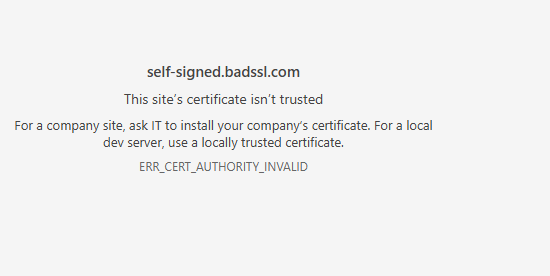

**TLS termination.** NPMplus requests and renews the certificate; Nginx inside it ends TLS on port 443 and forwards plain HTTP to `127.0.0.1:8000`, which never leaves the VM. The app code doesn't change at all. In production, Azure Application Gateway or Front Door would do the same job as a managed service.

### Web Application Firewall

TLS protects the *pipe*; a WAF inspects *what travels through it*. CrowdSec's AppSec component runs the **OWASP Core Rule Set (CRS)**. Each rule that matches a request adds to an **anomaly score**, and above the threshold the request is blocked with `403` before it reaches the app. CrowdSec also recognizes repeat offenders and can ban an IP outright.

## 3. Close it

### Change the NPMplus admin password (F-12)

In the admin panel (via the tunnel, `https://localhost:8081`): user menu → **Change Password**. The NPMplus audit log records the change:

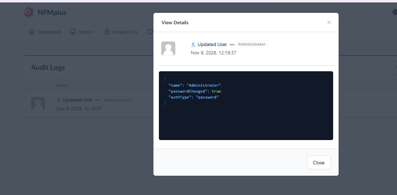

### Enable TLS (Demo 5)

Proxy host → **TLS** tab: **Request a new certificate** (Let's Encrypt), **Force HTTPS**, **HSTS** (2 years). HSTS tells browsers to use HTTPS only for this domain from then on, so a later attacker cannot downgrade them to HTTP.

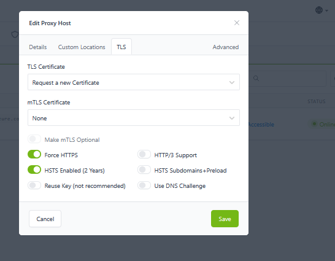

Port 80 stays open in the NSG for two reasons: Let's Encrypt's HTTP-01 challenge uses it to verify the domain, and it redirects users who type `http://`.

### Enable the WAF (Demo 6)

On the VM:

```bash
sudo docker exec crowdsec cscli bouncers add npmplus     # prints an API key once
sudo nano /opt/npmplus/crowdsec/crowdsec.conf
#   ENABLED=true
#   API_URL=http://127.0.0.1:8080
#   APPSEC_URL=http://127.0.0.1:7422
#   API_KEY=<the key>
cd /opt/npmplus && sudo docker compose restart npmplus
```

I did all admin-panel changes **before** enabling the WAF. The WAF also protects the admin panel, and tunnel traffic arrives as `127.0.0.1`, so unusual-looking admin API calls can get the tunnel banned.

## 4. Prove it's closed

**HTTP redirects to HTTPS:**

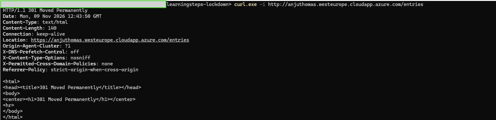

**HTTPS works, with HSTS:** `200 OK` on port 443 and `Strict-Transport-Security: max-age=63072000` (2 years).

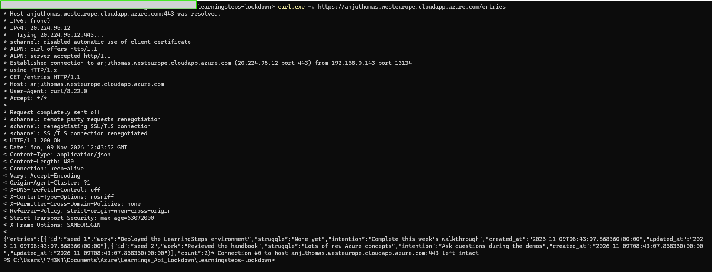

**The certificate is valid and trusted.** It was issued by Let's Encrypt's intermediate **YE1**. The connection uses **TLS 1.3** with **AES-256-GCM** and **X25519MLKEM768**, a hybrid key exchange that adds the post-quantum algorithm ML-KEM, so recorded traffic stays protected even against future quantum computers.

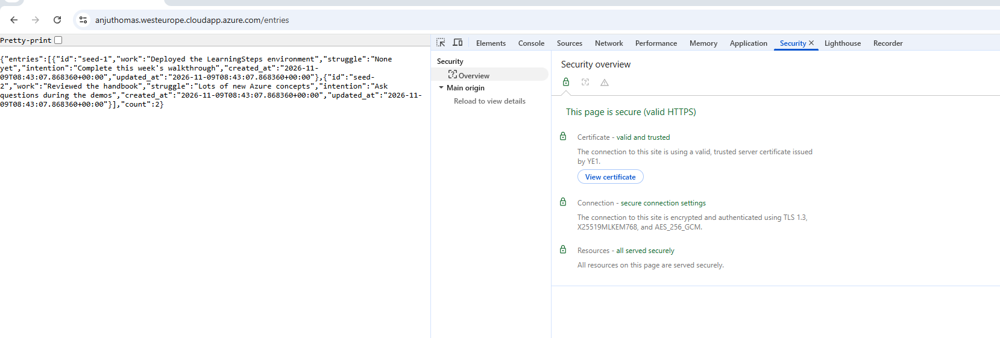

**The same Wireshark capture is now unreadable.** It shows only TLSv1.3 records. One thing is still visible: the hostname `anjuthomas.westeurope.cloudapp.azure.com` in the TLS handshake (the **SNI** field, which tells the server which certificate to send). TLS hides content, paths, headers and data, but not IP addresses or the hostname.

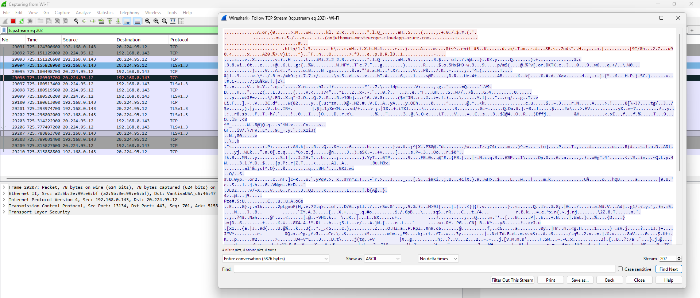

**The same attack payloads are now blocked** with `403 Forbidden`:

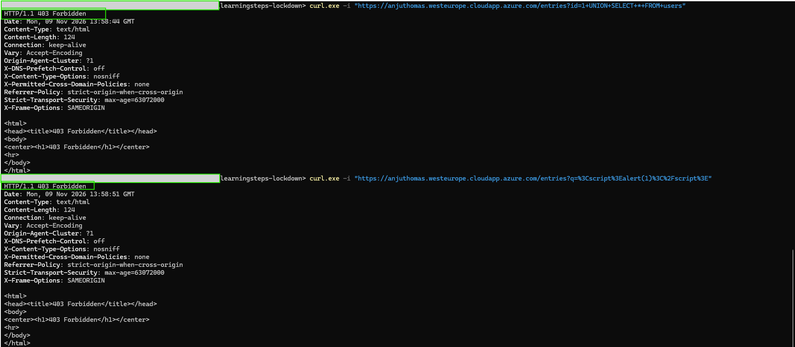

**CrowdSec logged both as WAF alerts:** `anomaly score block: sql_injection: 40` and `anomaly score block: xss: 40`, `kind: waf`.

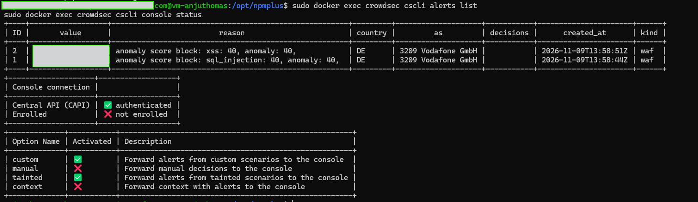

## Read the fine print: CrowdSec shares signals

`cscli console status` shows **Central API (CAPI): authenticated**. By default CrowdSec sends signals about detected attacks (attacker IP, scenario, time) to its central service and receives the community blocklist in return. The console itself is **not enrolled**, so no extra data such as request context goes to the CrowdSec web console. My two test attacks came from my own home IP, so that IP was probably reported as an attacker. For a lab this is acceptable, and the community blocklist is a real benefit. In production I would check the data-sharing terms against GDPR and company policy before keeping it on.

## Trade-offs and what is still open

- **Anyone can still read, change and delete entries.** TLS protects the connection, not the API. Phase 3 adds an identity gate.
- **No rate limiting yet.** The WAF blocks malicious *content*, but a flood of valid requests would still reach the app. CrowdSec scenarios or an Nginx `limit_req` rule would add it.
- **The NPMplus configuration lives only on the VM** (GUI changes), not in Terraform. Rebuilding the VM would lose it.
- **Port 80 is still open,** but only to redirect and for certificate renewal.

## Files changed

None. Phase 2 is configuration on the VM (NPMplus GUI, CrowdSec config), recorded here and in the screenshots.
