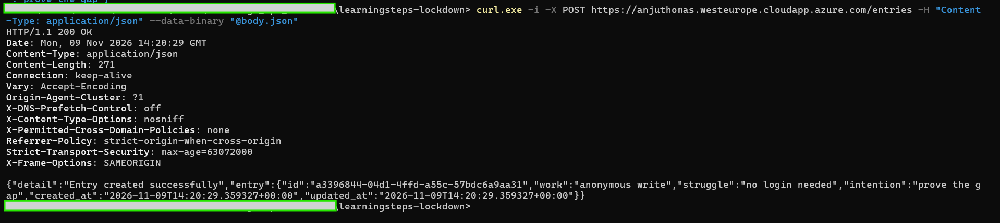
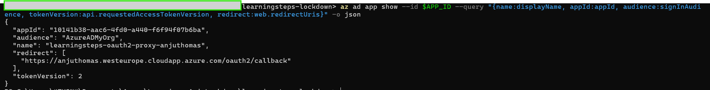
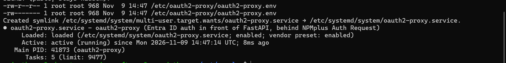
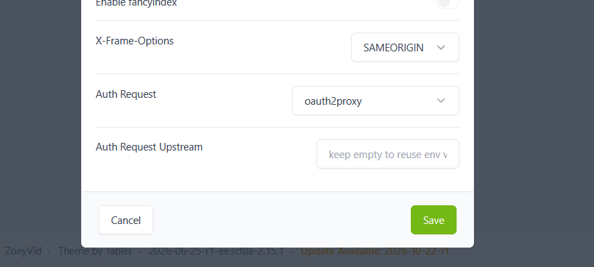
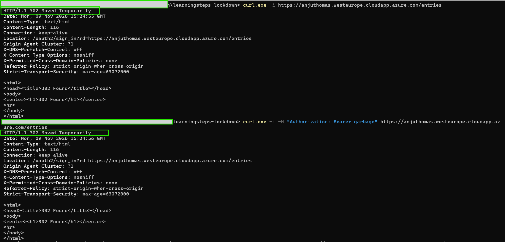
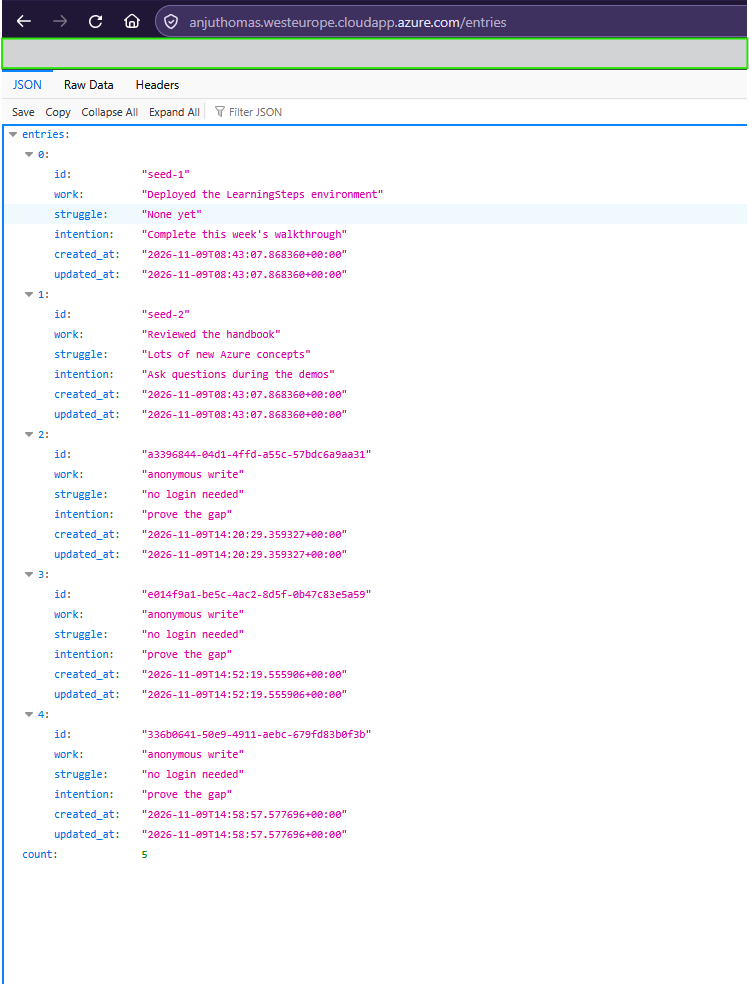
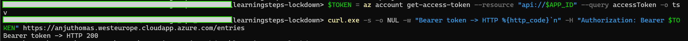
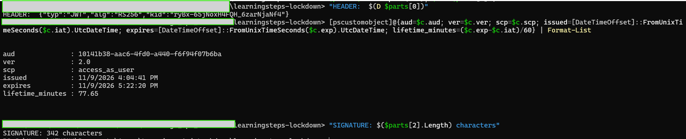
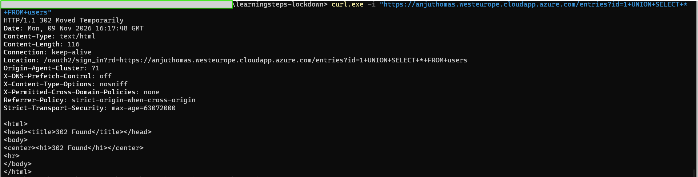
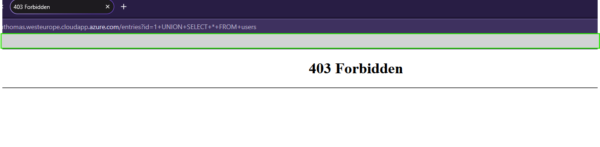

# Phase 3 — Identity-Based API Access

**Course:** LearningSteps Lockdown, Part 3 · **Date:** 2026-11-09 · **Closes:** F-05 · **Tag:** `phase-3-identity`

The API is no longer a "public utility." Every request must carry a valid Entra ID identity: either a browser session after a Microsoft login (with MFA), or a signed JWT bearer token issued for this API. Anonymous requests, including attack payloads, are redirected to the login (`302`) before they reach FastAPI. The application code is unchanged; identity is enforced by oauth2-proxy behind NPMplus.

```text
Browser / client ──HTTPS──▶ NPMplus (Nginx)
                              │ 1. auth_request ──▶ oauth2-proxy (127.0.0.1:4180) ──▶ Entra ID (OIDC)
                              │      no valid session/token → 302 to Microsoft login
                              │ 2. CrowdSec WAF (only for requests that passed step 1)
                              ▼
                           FastAPI (127.0.0.1:8000)
```

## 1. Show the gap

Anyone on the internet could create (and change or delete) journal entries with no login, no audit trail and no way to block one person:

```powershell
curl.exe -i -X POST https://anjuthomas.westeurope.cloudapp.azure.com/entries -H "Content-Type: application/json" --data-binary "@body.json"
```

`200 OK — Entry created successfully`, with no credentials at all.



I did not test `DELETE /entries`, because it wipes every entry and the data is needed for the Phase 4 backup. The POST proves the same point.

## 2. Explain the fix

### API keys vs identity

| | Shared API key | Entra ID identity (JWT) |
|---|---|---|
| What it is | A static string | A signed token issued to one person after login |
| Expiry | Never, unless someone rotates it | About 60–90 minutes (mine: 77.65 min) |
| Attribution | "The key was used" — by whom? | Every token names one account |
| Revoking one user | Rotate the key and break everyone | Disable or remove that one account |
| MFA | No | Yes, at login |
| Leak risk | Spreads into configs, chats, CI pipelines | Short-lived; useless soon after |

This is the same lesson as Phase 1 (SSH key file vs Entra ID login), one layer higher: replace something you *have* forever with something that proves *who you are* right now.

### What a JWT is

A JSON Web Token has three base64url parts separated by dots: **header**, **payload** (claims) and **signature**. The header and payload are only *encoded*, not encrypted; anyone can read them. The signature is made with Entra ID's private key, so any change to the token breaks it. oauth2-proxy downloads Entra's public keys and checks the signature, the issuer, the audience and the expiry.

### How oauth2-proxy fits

NPMplus sends an `auth_request` subrequest to oauth2-proxy for every request. oauth2-proxy answers yes or no:

- **Valid session cookie** (after a browser login) or **valid bearer token** → the request continues to the WAF and FastAPI.
- **Nothing valid** → `302` to `/oauth2/sign_in`, which starts the Microsoft login (OIDC authorization code flow).

The managed alternative for production would be Microsoft Entra Application Proxy.

## 3. Close it

### Demo 1 — Register an Entra ID application

```powershell
$APP_ID = az ad app create --display-name learningsteps-oauth2-proxy-anjuthomas --sign-in-audience AzureADMyOrg --query appId -o tsv
az ad app update --id $APP_ID --identifier-uris "api://$APP_ID"
az ad sp create --id $APP_ID
$SECRET = az ad app credential reset --id $APP_ID --display-name lockdown --end-date 2026-12-31 --query password -o tsv
```

Then, through Microsoft Graph: v2 access tokens (`requestedAccessTokenVersion: 2`), an exposed scope `access_as_user`, and the reply URL `https://anjuthomas.westeurope.cloudapp.azure.com/oauth2/callback`. The reply URL must be HTTPS, which only works because of Phase 2.

- **`AzureADMyOrg`**: only accounts of the Cybersteps tenant can sign in.
- **`--end-date 2026-12-31`**: the client secret expires in weeks, not after the default one year.



### Demo 2 — Configure and start oauth2-proxy

On the VM, I read the values with `read -s` (hidden input, so the client secret never appears on screen or in the shell history) and wrote them into `/etc/oauth2-proxy/oauth2-proxy.env` with `sed`.

**An extra finding:** the env file holding the client secret and the cookie secret was **`-rw-r--r--`**, readable by every user on the VM. I restricted it to root with `chmod 600`:



### Demo 3 — Wire the gate into NPMplus

Proxy host → **Auth Request: oauth2proxy**:



## Problems I had to solve

| Symptom | Cause | Fix |
|---|---|---|
| `az ad app create` → *Insufficient privileges* | An app named `learningsteps-oauth2-proxy` (the handbook's name) already existed in the shared tenant. The CLI silently tried to **modify** that other person's app; only ownership stopped it | A unique name: `learningsteps-oauth2-proxy-anjuthomas` |
| Saving Auth Request in NPMplus → *JSON.parse: unexpected character* | The **WAF blocked my own admin request** (tunnel traffic arrives as `127.0.0.1`) and returned an HTML 403 page instead of JSON: a false positive | Disabled the WAF briefly, saved, enabled it again |
| Gate "saved" but every request still `200` | The setting never reached Nginx. `grep oauth2 /opt/npmplus/nginx/proxy_host/1.conf` found nothing, only `auth_request off;` | Set `npmplus_auth_request: oauth2proxy` through the NPMplus API with the WAF off, then checked the generated config |
| Login worked, then oauth2-proxy `500` | Log: *"neither the id_token nor the profileURL set an email"*. Cybersteps accounts have no `email` claim | `OAUTH2_PROXY_OIDC_EMAIL_CLAIM=preferred_username` |
| Log: *"Rejecting invalid redirect … not in whitelist"* | oauth2-proxy only redirects back to known domains (open-redirect protection) | `OAUTH2_PROXY_WHITELIST_DOMAINS=anjuthomas.westeurope.cloudapp.azure.com` |
| `az account get-access-token --resource api://…` → `AADSTS65001` | Nobody had consented to the Azure CLI using my API | As app owner, pre-authorized the Azure CLI client for `access_as_user` |

The lesson from the third row: **a UI saying "saved" is not proof.** Only reading the generated config and testing from outside showed that the gate was still off. Three anonymous entries were created before the gate really worked.

## 4. Prove it's closed

**Anonymous requests and fake tokens are redirected to the login:**

```powershell
curl.exe -i https://anjuthomas.westeurope.cloudapp.azure.com/entries
curl.exe -i -H "Authorization: Bearer garbage" https://anjuthomas.westeurope.cloudapp.azure.com/entries
```

Both return `302` to `/oauth2/sign_in`; a malformed token gets no free pass.



The oauth2-proxy log also showed a stranger: an Amazon AWS address (`3.87.102.186`) requested the site seconds after my first login attempt, most likely a scanner or link-preview bot, and received `401` and a redirect to the login.

**After a Microsoft login (with MFA), the browser gets the data:**



**A real Entra ID access token for this API is accepted** (`HTTP 200`, no browser involved):

```powershell
$TOKEN = az account get-access-token --resource "api://$APP_ID" --query accessToken -o tsv
curl.exe -s -o NUL -w "Bearer token -> HTTP %{http_code}`n" -H "Authorization: Bearer $TOKEN" https://anjuthomas.westeurope.cloudapp.azure.com/entries
```



**The token, decoded locally** (never pasted into a website):

| Part | Value | Meaning |
|---|---|---|
| Header `alg` | `RS256` | Signed with Entra ID's RSA private key |
| Header `kid` | `ryBx-65j…` | Which Entra signing key; oauth2-proxy uses it to pick the public key |
| `aud` | `10141b38-…` (my app ID) | Valid only for **this** API |
| `ver` | `2.0` | The v2 format oauth2-proxy expects |
| `scp` | `access_as_user` | The scope I exposed |
| Lifetime | 77.65 minutes | Expires on its own |
| Signature | 342 characters | A 2048-bit RSA signature, base64url-encoded |



### Do we still need the WAF? Yes.

The same SQL injection URL that the WAF answered with `403` in Phase 2 now returns `302` when sent anonymously. The identity check runs first, so the WAF never sees the payload:



Sent from my **logged-in** browser session, the WAF still blocks it with `403`:



**Identity checks *who*; the WAF checks *how*.** A legitimate user, or an attacker with a stolen session, can still send malicious input, and only the WAF stops that. The layering also has a cost: anonymous attacks no longer produce WAF alerts, so detection sees less of them.

## Trade-offs and what is still open

- **Any account in the Cybersteps tenant can log in**, not only me (`AzureADMyOrg` + `--email-domain=*`). Next step: set *Assignment required* on the enterprise app and assign only specific users or a group.
- **`preferred_username` as the user name** is fine for display and logging in a single-tenant app. Microsoft advises against using it for authorization decisions, because it can change; `oid` would be the stable identifier.
- **The client secret is still a file on the VM** (`chmod 600`, expires 2026-12-31). A certificate credential, or the secret in Key Vault read with the VM's managed identity, would be better; the same next step applies to the database password (see the README).
- **The Azure CLI is pre-authorized for my API**, so anyone in the tenant can get a token for it with `az` without a consent prompt. That's fine for a lab; in production I would only pre-authorize my own client apps.
- **NPMplus and oauth2-proxy configuration lives only on the VM**, not in Terraform.

## Files changed

| File | Change |
|---|---|
| `.gitignore` | Ignore `login.json` (NPMplus API login body) |

Everything else is configuration in Entra ID and on the VM, recorded above.
