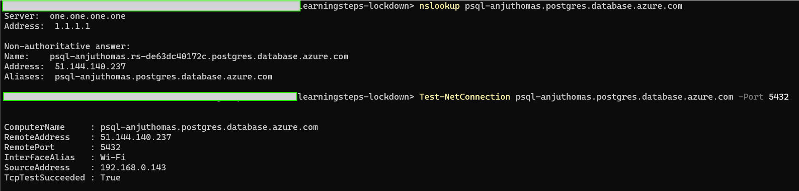
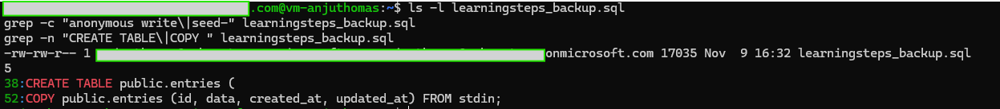
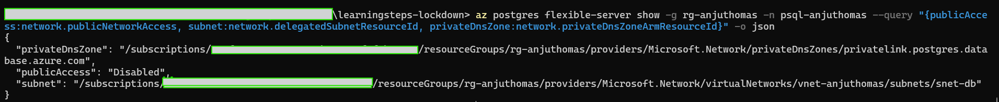
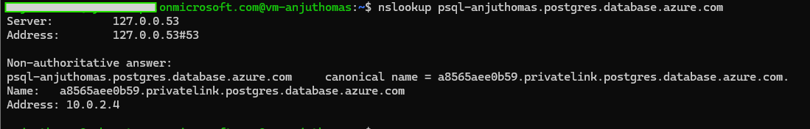
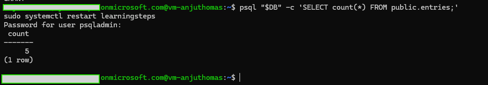
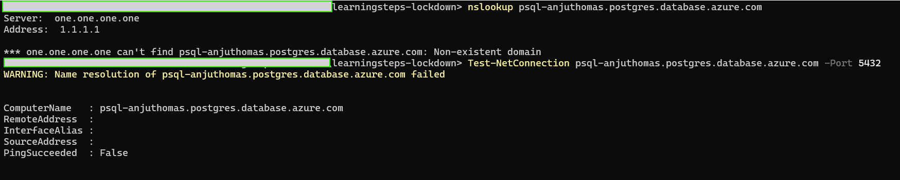
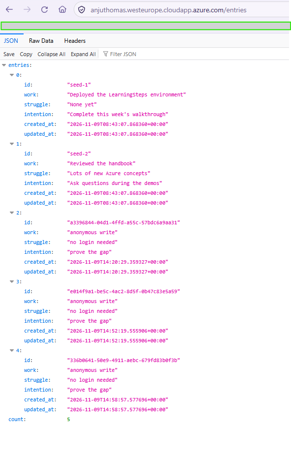

# Phase 4 — Data Isolation

**Course:** LearningSteps Lockdown, Part 4 · **Date:** 2026-11-09 · **Closes:** F-06 (bonus: F-08) · **Tag:** `phase-4-data-isolation`

The database, the "crown jewel" of the system, no longer has a public endpoint. PostgreSQL now sits in its own delegated subnet (`snet-db`, 10.0.2.0/24) with a private IP, and its hostname only resolves inside the virtual network. From the internet it can't be resolved, scanned or reached. Only the VM can talk to it, over the Azure backbone. The migration recreated the server, so I did it **backup-first**: dump → migrate → restore → verify, with no data lost.

```text
Before:  VM (10.0.1.4) ──public internet──▶ PostgreSQL (public IP 51.144.140.237, firewall 0.0.0.0–255.255.255.255)
         Anyone      ──public internet──▶ PostgreSQL :5432

After:   VM (10.0.1.4) ──Azure VNet backbone──▶ PostgreSQL (private IP 10.0.2.4 in snet-db)
         Anyone      ──✗ name does not even resolve
```

## 1. Show the gap

From my laptop, with no VM and no tunnel, the database hostname resolved to a **public** IP, and port 5432 accepted connections:



The risks:

- **Direct attacks.** Bots scan the internet for 5432, the default PostgreSQL port. With the firewall rule `allow-all` (0.0.0.0–255.255.255.255), every scanner could try the admin login directly, bypassing the NSG, TLS, the WAF and the identity gate.
- **Traffic over the internet.** The app's database traffic left Azure's network and crossed the public internet. TLS (`sslmode=require`) protected it, but the path was exposed.

## 2. Explain the fix

**VNet integration** puts the Flexible Server *inside* the virtual network. It gets a private IP in a subnet **delegated** to `Microsoft.DBforPostgreSQL/flexibleServers`, and it gets no public endpoint at all.

- **Private DNS zone** `privatelink.postgres.database.azure.com`, linked to the VNet: inside the VNet, the same hostname `psql-anjuthomas.postgres.database.azure.com` resolves to the private IP. The app's connection string doesn't change.
- **No public attack surface:** there is no public IP to scan and no firewall rule to get wrong.
- **Traffic stays on the Azure backbone** between the VM and the database.

**Why back up first?** A server cannot be switched from public access to VNet integration in place. Setting `delegated_subnet_id` forces Terraform to **destroy and recreate** the server, and everything in it is lost without a backup.

**VNet integration vs Private Link.** The course uses VNet integration. Microsoft's more modern option is **Private Link**: the server stays a normal PaaS resource and gets a *private endpoint* (a private IP in any subnet). It isolates just as well, works across VNets and regions, and supports more services. VNet integration is simpler for a single-VNet lab.

## 3. Close it

### Back up the database (Demo 2)

I made the dump **on the VM**, because its `pg_dump` 16 matches the server and nothing needs installing on Windows:

```bash
pg_dump "postgresql://psqladmin@psql-anjuthomas.postgres.database.azure.com/learning_journal?sslmode=require" > learningsteps_backup.sql
```

17 KB with `CREATE TABLE public.entries`, a `COPY` data block and all **5 entries** (2 seed entries plus the 3 anonymous writes from Phase 3):



I kept **two copies**: one on the VM's disk, which the database migration doesn't touch, and one on my laptop (`scp` through the Entra ID SSH config into `backups/`, which is git-ignored so real data never reaches GitHub).

### Migrate to VNet integration (Demo 3)

| File | Change |
|---|---|
| `network.tf` | New subnet `snet-db` (10.0.2.0/24) delegated to Flexible Server; private DNS zone `privatelink.postgres.database.azure.com`; VNet link |
| `postgresql.tf` | `public_network_access_enabled = false`, `delegated_subnet_id`, `private_dns_zone_id`; **deleted** the `allow_all` firewall rule |
| `vm.tf` | Removed the `depends_on` reference to the deleted firewall rule |

**I checked the plan before touching anything.** The plan was saved to a file (`-out phase4.tfplan`) and limited with `-target` to the database, so the `created-on` tag drift from Phase 1 stayed out:

- **5 to add:** subnet, DNS zone, VNet link, new server, new database
- **3 to destroy:** old server, old database, `allow-all` firewall rule
- **2 to change:** only the Azure Policy `created-on` tag on the resource group and the VNet
- **The VM is not in the plan.** This was the most important check. `vm.tf` builds the connection string from the static name `psql-${var.prefix}`, not from the server's live `fqdn` attribute, so replacing the database does not force a VM replacement. A VM replacement would have wiped NPMplus, CrowdSec and oauth2-proxy.

```powershell
terraform apply phase4.tfplan     # applies exactly the reviewed plan, nothing else
```

Azure confirms the result: public network access **Disabled**, the server delegated into `snet-db`, and the private DNS zone attached:



### Restore through the VM (Demo 4)

Inside the VNet, the hostname is now a CNAME to `<id>.privatelink.postgres.database.azure.com`, which the linked private DNS zone resolves to **`10.0.2.4`**, a private address in `snet-db`. (`127.0.0.53` is the VM's local DNS stub, which forwards to Azure DNS.)



The new database was empty. I restored from the VM, which now acts as the jump host, then restarted the app so it opened a fresh connection:

```bash
psql "$DB" -v ON_ERROR_STOP=1 -f ~/learningsteps_backup.sql
psql "$DB" -c 'SELECT count(*) FROM public.entries;'     # 5
sudo systemctl restart learningsteps
```



## 4. Prove it's closed

**From my laptop, the database cannot even be found.** Public DNS answers *Non-existent domain*, and `Test-NetConnection` fails at name resolution. There is no public IP left to attack. (Part 4 quiz: a laptop outside the VNet has no route to the private 10.0.x.x address space; only resources inside the VNet can reach it.)



**The app recovered with all data.** Logged-in browser: all 5 entries, the same as before the migration:



## Trade-offs and what is still open

- **Downtime:** the app could not reach a database for about 5–10 minutes during the recreation, plus the restore. In production this would be a planned maintenance window, or a migration to a new server followed by a cut-over.
- **No NSG on `snet-db`.** Inside the VNet any subnet can reach port 5432. An NSG allowing 5432 only from `snet-app` (10.0.1.0/24) would add defence in depth.
- **The DB admin password is still in plaintext on the VM** (systemd unit, cloud-init data), and the app still connects as the admin user. The bonus below and Phase 5 deal with this.
